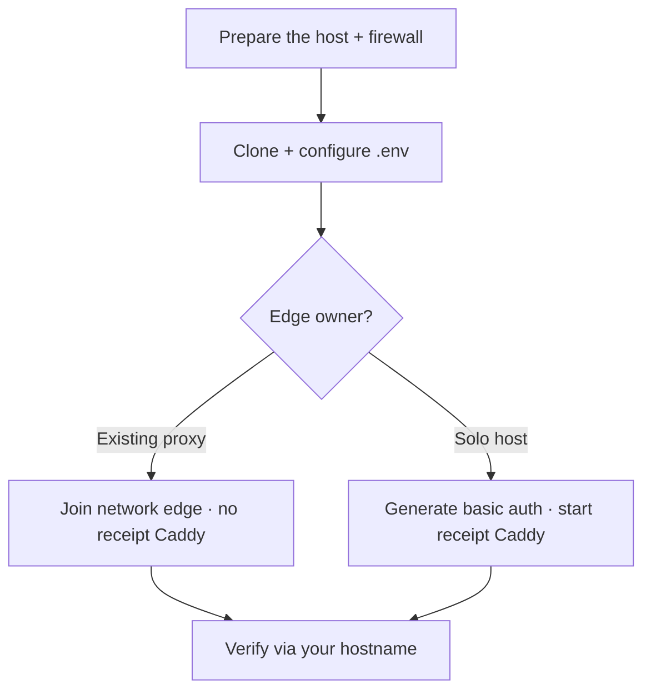

# Deployment Guide

> **Operator-only.** This guide is for you when you stand the demo up. The visitor path is the [README](README.md).

## Background

For operators standing up the Receipt Intelligence demo on one host: Docker Compose (n8n writer + API reader) with HTTPS at the edge.

Product overview: [README](README.md). Architecture diagram: [docs/product/architecture.md](docs/product/architecture.md). This guide covers **firewall → `.env` → up → verify**.

## Which path?

| Path | When | Compose files | Who owns 80/443 |
|------|------|---------------|-----------------|
| **[Behind an existing reverse proxy](#-behind-an-existing-reverse-proxy)** | Another reverse proxy already owns 80/443 on the host | base + `docker-compose.shared-edge.yml` | **Existing reverse proxy** (do not start this repo’s Caddy) |
| **[Solo host (own Caddy)](#-deploy-on-a-linux-host-solo-caddy)** | A Linux host with Docker for this demo only | base + `docker-compose.caddy.yml` | **This repo’s Caddy** |

Live demo: `https://receipt-intelligence.roxanatapia.dev`



> **Takeaway:** Publish only **22 / 80 / 443**. App ports stay off the public internet. When a reverse proxy already owns those ports, **never** run a second Caddy from this repo.

---

## ✅ Prerequisites

| Requirement | Notes |
|-------------|-------|
| **Docker 24+** | Compose v2 plugin (`docker compose`) |
| **git** | Clone this repo + sibling API (build context) |
| **SSH access** | A Linux host with Docker (Ubuntu/Debian) |
| **Outbound internet** | Image pulls + automatic TLS (domain mode) |
| **Domain (optional)** | Needed for ACME TLS; otherwise use [IP-interim](#ip-interim-no-domain-yet) |

Human ops (not automated here): create the host, point DNS A/AAAA at it when you have a domain.

---

## 💻 Host

A small Linux host with Docker is enough for this demo. Leave space for images and for receipt JSON under `data/receipts/`.

---

## 🌐 What ports are public?

| Port | Public? | Role |
|------|---------|------|
| **22** | Yes | SSH |
| **80** | Yes | HTTP → ACME / redirect (Caddy) |
| **443** | Yes | HTTPS (Caddy) |
| **8000** | No | API — Compose network only |
| **5678** | No | n8n — Compose network only |
| **8080** | No | Demo UX — Compose network only |

Local smoke **without** Caddy still publishes API / n8n / UX on the host (see [README](README.md)). The Caddy and shared-edge overlays strip those host publishes with `ports: !override []`.

---

## 🔐 Environment

The HTTPS paths set these in `.env` once. The solo path shows how you copy `.env.example`.

```bash
N8N_BASIC_AUTH_PASSWORD=change-me-strong
ANTHROPIC_API_KEY=          # if you will run workflows / Q&A

COMPOSE_PROJECT_NAME=receipt-intelligence-demo
N8N_PROTOCOL=https
N8N_BASIC_AUTH_ACTIVE=false
```

Each path below adds its hostnames. Use your own.

---

## 🔗 Behind an existing reverse proxy

Use this when another reverse proxy already terminates TLS on the host. Receipt containers join Docker network `edge`; that proxy reaches them by the aliases below. TLS and basic auth stay in the existing proxy’s own config.

⚠️ **Do not** run `deploy/docker-compose.caddy.yml` on that host — it will fight the existing proxy for ports 80/443.

### 1. Network (once)

```bash
docker network create edge   # ignore error if it already exists
```

### 2. Path settings

Same sibling layout as the solo path. Shared keys are in [Environment](#-environment). When you are **behind an existing reverse proxy**, add these (placeholders — use your own hostnames):

```bash
# Public URL behind the existing reverse proxy — n8n on its own host (root path).
# Point DNS for both names at this host.
N8N_HOST=n8n.example.com
N8N_PATH=/
WEBHOOK_URL=https://n8n.example.com/
N8N_EDITOR_BASE_URL=https://n8n.example.com/
N8N_PROXY_HOPS=1
```

Use `N8N_PATH=/` (not empty) on that host so editor assets are absolute (`/assets/…`). Empty path makes relative `assets/…` URLs that 404-as-HTML on `/home/workflows` (blank page after login).

Leave `SITE_ADDRESS` / `ACME_EMAIL` / `CADDYFILE` unset in **this** repo's `.env`. TLS and basic auth live in the existing reverse proxy, not in this repo.

### 3. Seed demo receipts, then start on `edge` (no Caddy from this repo)

```bash
./deploy/seed-demo-data.sh

docker compose --env-file .env -p receipt-intelligence-demo \
  -f deploy/docker-compose.yml -f deploy/docker-compose.shared-edge.yml up --build -d

docker compose --env-file .env -p receipt-intelligence-demo \
  -f deploy/docker-compose.yml -f deploy/docker-compose.shared-edge.yml ps
```

Expect: `api` healthy · `n8n` Up · `ux` Up · **no** `caddy` service · host does **not** publish 8000/5678/8080.

Stable aliases on `edge` for the external proxy:

| Alias | Port | Role |
|-------|------|------|
| `receipt-api` | 8000 | API (`/health`, `/analytics/*`, `/questions`) |
| `receipt-n8n` | 5678 | n8n operator UI |
| `receipt-ux` | 8080 | Visitor demo UX |

⚠️ **Existing reverse proxy:** point protected `/app*` at `receipt-ux:8080` and **strip the `/app` prefix** (`handle_path /app/*`). Serve n8n on its own host (for example **`n8n.example.com`**) at `/` (`N8N_PATH=/`). Path-prefix `/n8n*` on the demo host hits n8n’s known login redirect bug — prefer a separate host.

Then [verify](#-verify).

---

## 🚀 Deploy on a Linux host (solo Caddy)

### 1. Prepare the host

```bash
sudo apt-get update && sudo apt-get install -y git ca-certificates curl
# Install Docker 24+ per https://docs.docker.com/engine/install/
sudo usermod -aG docker "$USER"   # log out and back in after this
```

**Firewall** — open only SSH and Caddy:

```bash
sudo ufw allow OpenSSH
sudo ufw allow 80/tcp
sudo ufw allow 443/tcp
sudo ufw enable
sudo ufw status
```

### 2. Clone and configure

Clone **this repo**. Place a sibling clone of the companion API (walkthrough on request) next to it, or set `API_BUILD_CONTEXT` to that clone.

```text
<parent>/                         # example clone layout
├── receipt-intelligence-api      # companion API (Compose default)
└── receipt-intelligence-demo
```

```bash
mkdir -p receipt-intelligence && cd receipt-intelligence
# Place the companion API clone next to this repo (walkthrough on request).
git clone https://github.com/RoxanaTapia/receipt-intelligence-demo.git
cd receipt-intelligence-demo
cp .env.example .env
nano .env
```

Minimum `.env` additions for **domain mode** (automatic TLS). Shared keys are in [Environment](#-environment). Add:

```bash
SITE_ADDRESS=demo.example.com
ACME_EMAIL=you@example.com

# Public URLs for n8n — prefer a dedicated host at root (avoids n8n path bugs).
# Path mode (N8N_PATH=/n8n/) still works for solo Caddy if you accept the login quirk.
N8N_HOST=n8n.demo.example.com
N8N_PATH=
WEBHOOK_URL=https://n8n.demo.example.com/
```

DNS: point `SITE_ADDRESS` A/AAAA at this host before the first Caddy up (ACME needs to reach :80/:443).

### 3. Generate basic-auth credentials

```bash
chmod +x deploy/generate-caddy-auth.sh deploy/generate-ip-tls.sh
./deploy/generate-caddy-auth.sh demo 'YOUR_STRONG_PASSWORD'
```

Writes `deploy/caddy-basicauth.conf` (gitignored). Re-run to rotate the password. Edge basic auth is separate from n8n’s own `N8N_BASIC_AUTH_*`.

### 4. Seed demo data and start the stack with Caddy

From the **repo root**:

```bash
./deploy/seed-demo-data.sh

docker compose --env-file .env -p receipt-intelligence-demo \
  -f deploy/docker-compose.yml -f deploy/docker-compose.caddy.yml up --build -d

docker compose --env-file .env -p receipt-intelligence-demo \
  -f deploy/docker-compose.yml -f deploy/docker-compose.caddy.yml ps
```

Expect: `api` healthy · `n8n` Up · `ux` Up · `caddy` Up. Host should **not** publish 8000/5678/8080.

Set `COMPOSE_PROJECT_NAME=receipt-intelligence-demo` in `.env` so you can omit `-p` later. Always pass `--env-file .env` when the first compose file lives under `deploy/`.

Then [verify](#-verify).

### Seed fixtures and demo currency

`demo/seed/` holds **fictional** merchants/items (not real retailers). Amounts are **demo currency (DC)** — the UX labels them; they are not EUR/USD. Analytics window defaults: `DEMO_START_DATE=2026-07-01`, `DEMO_END_DATE=2026-08-31` (cover seed + live sample dates). See `demo/seed/README.md`.

### Live sample PDF (operators)

Visitors download → upload under `/app` (primary sample id `sample-supermarket-receipt`). The UX calls `N8N_INGEST_WEBHOOK_URL` on the Compose network only (`http://n8n:5678/webhook/receipt-demo-ingest` by default) — the browser never reaches n8n.

After any n8n volume reset:

1. Open the n8n host (`https://n8n.example.com/` when n8n has its own host; solo path mode: `/n8n*`). Edge Basic Auth, then n8n **owner** login — keep `N8N_BASIC_AUTH_ACTIVE=false` so you are not challenged twice.
2. Import the receipt PDF ingest workflow if missing (companion n8n; walkthrough on request).
3. Toggle the workflow **Active / Published** (import alone is not enough — inactive workflows do not register `/webhook/receipt-demo-ingest`).
4. Smoke from the UX container:

```bash
docker compose --env-file .env -p receipt-intelligence-demo \
  -f deploy/docker-compose.yml -f deploy/docker-compose.shared-edge.yml \
  exec ux wget -qO- --post-data='{"sample":"sample-supermarket-receipt"}' \
  --header='Content-Type: application/json' \
  http://n8n:5678/webhook/receipt-demo-ingest
```

Expect JSON with `"ok": true` and `persistedFilename`. “Webhook not registered” means the workflow is not Active.

Sample PDFs: `demo/samples/` mounted into n8n. The ingest webhook lives in the companion n8n (walkthrough on request).

---

## ✅ Verify

Run this after the stack is up. Q&A needs `ANTHROPIC_API_KEY` in `.env`.

| Path | Surface |
|------|---------|
| `/app` | **Visitor demo UX** (download sample → upload → live ingest → spending → ask) |
| `/health`, `/docs`, `/analytics/*`, `/questions` | API |
| n8n host `/` (own host) or `/n8n/` (solo path mode) | n8n operator UI |

`YOUR_HOST` is the demo hostname for the path you chose (`demo.example.com` behind an existing reverse proxy, or `YOUR_DOMAIN` on solo Caddy). The password is that proxy’s edge password, or the one you generated for solo Caddy.

```bash
# 401 without credentials
curl -sk -o /dev/null -w "%{http_code}\n" https://YOUR_HOST/health

# {"status":"ok"}
curl -sk -u demo:YOUR_PASSWORD https://YOUR_HOST/health

# 200 after /app* reaches the visitor UX
curl -sk -o /dev/null -w "%{http_code}\n" -u demo:YOUR_PASSWORD https://YOUR_HOST/app/
```

**Behind an existing reverse proxy.** End-to-end HTTPS and the invite gate are owned by the existing reverse proxy, not this stack. Visitor path on your host:

`https://demo.example.com/` → invite or Login → **`/app`** (download sample → upload → live ingest → ask). Operators activate the ingest workflow at `https://n8n.example.com/` (edge Basic Auth).

Before those proxy routes answer, confirm the backends from another container on `edge`:

```bash
docker run --rm --network edge curlimages/curl:8.5.0 \
  -sS http://receipt-api:8000/health
docker run --rm --network edge curlimages/curl:8.5.0 \
  -sS http://receipt-ux:8080/health
```

**Solo Caddy.** Open `https://YOUR_DOMAIN/app` after the browser basic-auth prompt. Caddy strips the `/app` prefix and forwards to the visitor UX.

---

## 📌 IP-interim (no domain yet)

Use when the host exists but DNS is not ready. Same public ports; self-signed TLS (browser warning expected).

```bash
# In .env — do not set SITE_ADDRESS for this mode
CADDYFILE=./Caddyfile.ip
# Path is relative to deploy/ when Compose resolves volumes.

./deploy/generate-caddy-auth.sh demo 'YOUR_STRONG_PASSWORD'
./deploy/generate-ip-tls.sh YOUR_PUBLIC_IP

# Optional: point n8n public URL at the IP (still path-prefixed)
N8N_HOST=YOUR_PUBLIC_IP
N8N_PROTOCOL=https
N8N_PATH=/n8n/
WEBHOOK_URL=https://YOUR_PUBLIC_IP/n8n/
```

```bash
docker compose --env-file .env -p receipt-intelligence-demo \
  -f deploy/docker-compose.yml -f deploy/docker-compose.caddy.yml up --build -d

curl -sk -o /dev/null -w "%{http_code}\n" -u demo:YOUR_PASSWORD https://YOUR_PUBLIC_IP/health
```

**Cutover IP → domain:** set `SITE_ADDRESS` + `ACME_EMAIL`, remove `CADDYFILE=./Caddyfile.ip`, update `N8N_HOST` / `WEBHOOK_URL`, recreate Caddy (`docker compose … up -d --force-recreate caddy`). The certificate is issued automatically.

---

## 🖥️ Local development (no Caddy)

Unchanged from [README](README.md): base compose only, host ports 8000/5678.

```bash
cp .env.example .env
# set N8N_BASIC_AUTH_PASSWORD

docker compose --env-file .env -f deploy/docker-compose.yml up --build -d
curl -s http://localhost:8000/health
```

To exercise Caddy locally, use IP-interim with `127.0.0.1` (self-signed) and the same two-file compose command.

---

## 🔧 Troubleshooting

| Symptom | Likely cause | Check |
|---------|--------------|-------|
| Connection refused on 443 | Firewall or Caddy down | `ufw status`; `docker compose … ps` |
| Browser TLS warning (domain mode) | DNS not pointing here / ACME failed | A/AAAA → this host; `docker compose … logs caddy` |
| 502 after login | Backend not ready | From stack: `exec` into a container and `wget -qO- http://api:8000/health` |
| `caddy-basicauth.conf: is a directory` | Bad bind path / project-directory misuse | Run compose from repo root **without** `--project-directory`; regenerate auth file |
| :8000 or :5678 reachable from the internet | Caddy / shared-edge overlay not applied | Confirm the right `-f` overlay and `ports: !override []` |
| `network edge declared as external but could not be found` | Network not created | `docker network create edge` |
| Port 80/443 already allocated | This repo’s Caddy started beside an existing reverse proxy | Stop this repo’s Caddy; use the [existing-proxy](#-behind-an-existing-reverse-proxy) overlay only |

---

## 📚 Related

| Doc | Role |
|-----|------|
| [README.md](README.md) | Local compose smoke |
| [AGENTS.md](AGENTS.md) | Tests, layout, and review note |
| Companion n8n (walkthrough on request) | Workflow import / sample PDFs |
