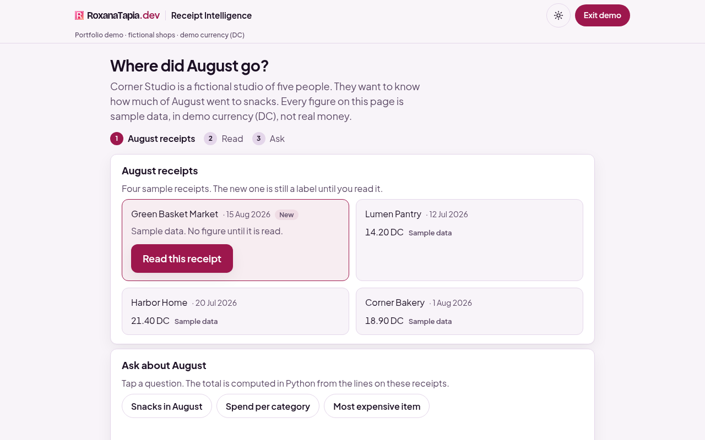
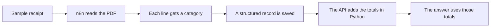

# Receipt Intelligence

> See a category on every line, then ask spending questions in plain language.

[](https://github.com/RoxanaTapia/receipt-intelligence-demo/actions/workflows/tests.yml)
[](LICENSE)
[](https://receipt-intelligence.roxanatapia.dev/)

🟢 **Live demo:** [receipt-intelligence.roxanatapia.dev](https://receipt-intelligence.roxanatapia.dev/)
▶ **Watch the demo:** [YouTube](https://youtu.be/m2YzXVfSf6c)
📄 **The case:** [Where did August go?](https://roxanatapia.dev/cases/receipts/)

[](https://receipt-intelligence.roxanatapia.dev/)

## The case

Corner Studio, a fictional studio, asks one question: where did the August snack money go? You open the sample receipt, each line gets a category, and the app adds the totals from the receipts on the page. If those receipts do not contain the spend, the demo says so.

This is a receipt-to-answers tool, not a chatbot that guesses a budget.

The merchants are fictional. Amounts on the page are demo figures. This is not for your real receipts.

## What it does

- 🧾 [Green Basket Market](demo/samples/sample-supermarket-receipt.pdf) is already on the page, dated 15 August 2026 and labelled SAMPLE RECEIPT
- 🏷️ You get a category on every line, not a single merchant guess
- 📊 Totals are added in Python from the receipts you can see
- 💬 Ask in plain language, for example "How much did I spend per category?"

Sample data from that receipt only (DC is demo currency, not real money):

| Category | Lines printed on the sample | Sample data |
|----------|-----------------------------|-------------|
| Food | Bananas 1.20, baby spinach 2.40, whole milk 1.80, Greek yogurt 2.60, sourdough loaf 3.80 | 11.80 DC |
| Drinks | Orange juice 2.90, sparkling water 1.50 | 4.40 DC |
| Snacks | Butter croissants 3.20 | 3.20 DC |
| Household | Dish soap 2.50, paper towels 3.10 | 5.60 DC |

The categories are the ones stored with the sample in [`demo/app/sample_receipt.py`](demo/app/sample_receipt.py). On this sample, August snacks are the croissants.

This is not accounting software. Tax export, bank sync, and multi-user accounts come later. Reading the receipt, saving it, and adding the totals stay the same.

## How it works



Hosted AI reads the merchant, the date, and each line, and later explains the totals. The totals themselves are calculated in Python, not guessed.

Reading the receipt happens in n8n workflows that live in their own repository. Totals and answers come from a FastAPI service that lives in its own repository.

## For engineers

### Stack

n8n, FastAPI, Claude, Docker Compose, and a Jinja visitor UI in this repo.

You do not open an n8n editor from the visitor demo. The browser never talks to n8n. n8n writes a JSON record for each receipt; the API reads that record and adds the totals.

### Quickstart

Clone this repo and a sibling clone of [`receipt-intelligence-api`](https://github.com/RoxanaTapia/receipt-intelligence-api). Copy `.env.example` to `.env` and fill in the values it asks for. Then, from this repo:

```bash
docker compose --env-file .env -f deploy/docker-compose.yml up --build -d
curl -s http://localhost:8000/health
```

The visitor UI is published on port 8080 in the base Compose file. Full operator steps, including how to point Compose at the API clone: [DEPLOYMENT.md](DEPLOYMENT.md).

### Automated tests

```bash
python3 -m pytest demo/tests
ruff check
ruff format --check
```

GitHub Actions runs the automated tests and Ruff on every pull request and every push to main ([`.github/workflows/tests.yml`](.github/workflows/tests.yml)). The workflow also confirms that the vendored demo kit still matches its checksum. The tests cover the visitor demo only. Commands: [AGENTS.md](AGENTS.md).

### Project structure

| Path | What it holds |
|------|----------------|
| [`demo/`](demo/) | Visitor UI (FastAPI and Jinja templates) |
| [`demo/seed/`](demo/seed/) | Fictional receipts already on the page |
| [`demo/tests/`](demo/tests/) | Automated tests for the visitor demo |
| [`deploy/`](deploy/) | Deployment files |
| [`docs/`](docs/README.md) | Architecture notes and the screenshot map |

Repo map: [docs/README.md](docs/README.md). Deploy picture: [docs/product/architecture.md](docs/product/architecture.md).

### Related repositories

| Repo | Role |
|------|------|
| **This repo** | Visitor UI and the Compose demo |
| [`receipt-intelligence-n8n`](https://github.com/RoxanaTapia/receipt-intelligence-n8n) | PDF ingest, categorization, JSON on disk |
| [`receipt-intelligence-api`](https://github.com/RoxanaTapia/receipt-intelligence-api) | Totals, REST API, and spending answers |

### How I build

I build with AI coding agents. Every change goes through a pull request I review and merge, with automated tests you can see on every change.

---

[MIT License](LICENSE) · [Roxana Tapia](https://github.com/RoxanaTapia) · [roxanatapia.dev](https://roxanatapia.dev) · [How I work with AI](docs/how-we-work.md)
