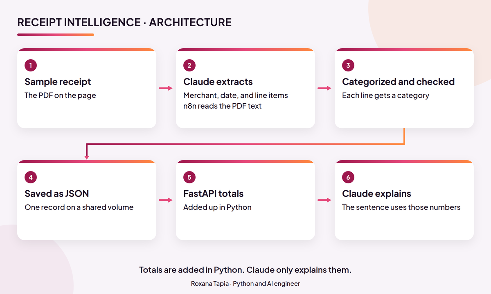

# Receipt Intelligence

> Use the sample receipt, see a category on every line, and ask spend questions in plain language.

> **Takeaway:** This is a receipt-to-answers pipeline, not a chatbot that guesses a budget. If the receipts do not contain the spend, it says so.

## Results

The demo app in this repository has 97 automated tests. GitHub Actions runs them on every pull request and on every push to main ([`.github/workflows/tests.yml`](.github/workflows/tests.yml)), and checks that the vendored demo kit still matches its checksum. The tests cover the visitor demo only.

## What works now

| What you can do | In practice |
|-----------------|-------------|
| **Sample receipt** | Read Green Basket Market on the page. The three seeded receipts are already there. Upload of that PDF stays with an operator session |
| **Line-item categories** | You get a category on every line, not a single merchant guess |
| **Spending answers** | Totals are calculated from the receipts on the page |
| **Plain-language Q&A** | Ask "How much did I spend per category?" |
| **Self-serve** | You do not open an n8n editor. The browser never talks to n8n. |

The merchants are fictional. Amounts on the page are demo figures. This is not for your real receipts.

## How it fits together

Each step exists to keep your answer inside receipts that were actually ingested.

| Step | Technique | Why? |
|------|-----------|------|
| **Read** | n8n extracts text from the PDF | Receipts are layouts, not spreadsheets. |
| **Extract** | Claude fills a receipt schema (merchant, date, line items) | Downstream steps need structured fields, not prose. |
| **Categorize** | Each line gets a category from a fixed taxonomy | You can ask "How much did I spend per category?" Totals cross merchants. |
| **Validate** | Schema and taxonomy checks, with a short retry | Invalid JSON never becomes the answer. |
| **Persist** | Canonical JSON on a shared volume | One store: n8n writes, the API reads. |
| **Analytics** | FastAPI aggregates by date and category | Totals are calculated, not guessed. |
| **Answer** | This page totals the receipts you can see | The sentence uses those numbers. It says when the receipts do not contain the spend. |

n8n · FastAPI · Claude · Docker Compose

## What's planned

This is not accounting software yet. Tax export, bank sync, and multi-user accounts come later. Reading the receipt, saving it, and calculating the totals stay the same.

## Try it

🟢 **Live** · <a href="https://receipt-intelligence.roxanatapia.dev/" target="_blank" rel="noopener noreferrer"><strong>receipt-intelligence.roxanatapia.dev</strong></a>

▶ **[Watch the demo](https://youtu.be/q03q0kfvTfQ)**

- Request an invite on the gate, then redeem the code
- Open the page and read Green Basket Market, 15 Aug. Then ask where the snacks went. The demo reads that one sample, not any other file
- The three seeded receipts are already on the page. Questions use those plus the receipt you read in this session
- A full-stack walkthrough is available on request. [Ask on Upwork](https://www.upwork.com/freelancers/roxanadev) or [contact me](https://roxanatapia.dev/#contact)

## Where things are

This repository is a portfolio demo of the visitor UI and the deployment setup.

| Path | What it holds |
|------|----------------|
| [`demo/`](demo/) | Visitor UI (FastAPI and Jinja templates) |
| [`deploy/`](deploy/) | Deployment files |
| [`docs/`](docs/) | Architecture notes and the screenshot map |

The extraction workflows and the API are not part of this repository.

Repo map: [docs/README.md](docs/README.md). Deploy picture: [docs/product/architecture.md](docs/product/architecture.md). Operator steps: [DEPLOYMENT.md](DEPLOYMENT.md).

---

[Roxana Tapia](https://github.com/RoxanaTapia) · [How I work with AI](docs/how-we-work.md) · [MIT License](LICENSE)
