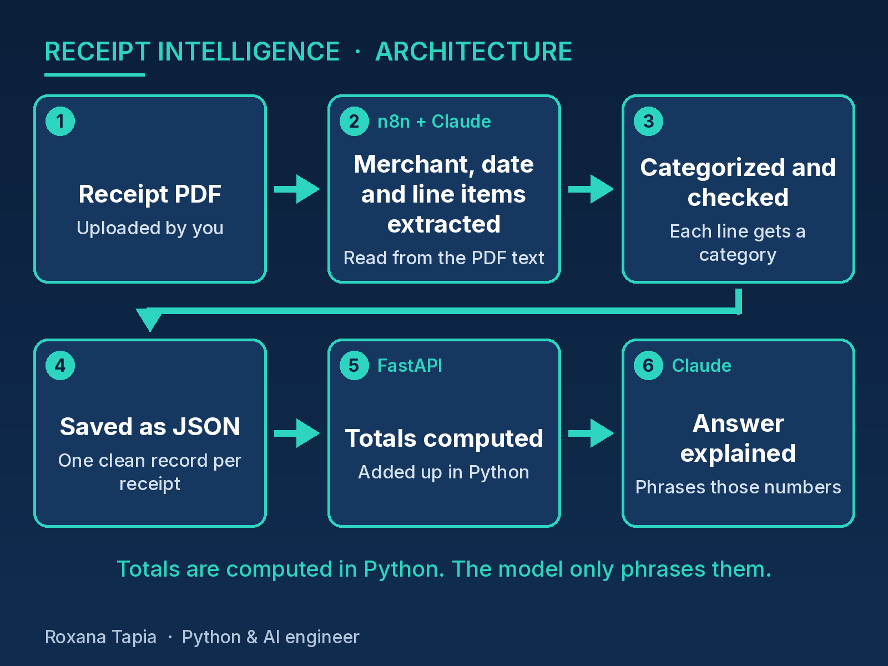

# Receipt Intelligence

> Upload a receipt PDF, get line-item categories, and ask spend questions in plain language.

> **Takeaway:** This is a receipt-to-answers pipeline, not a chatbot that guesses a budget. If the receipts do not contain the spend, it says so.

---

## What works now

| What you can do | In practice |
|-----------------|-------------|
| **Live ingest** | You see categories on the same page |
| **Line-item categories** | You get a category on every line, not a single merchant guess |
| **Spending context** | You see totals by category in a date window you can change |
| **Plain-language Q&A** | Ask "How much did I spend per category?", not how to read a JSON file |
| **Self-serve** | You do not open an n8n editor. The browser never talks to n8n. |

The demo uses fictional merchants and demo currency (DC). It is not for your real receipts.

## How it fits together

Each step exists to keep your answer inside receipts that were actually ingested.

| Step | Technique | Why? |
|------|-----------|------|
| **Read** | n8n extracts text from the PDF | Receipts are layouts, not spreadsheets. |
| **Extract** | Claude fills a receipt schema (merchant, date, line items) | Downstream steps need structured fields, not prose. |
| **Categorize** | Each line gets a category from a fixed taxonomy | You can ask "How much did I spend per category?" Totals cross merchants. |
| **Validate** | Schema and taxonomy checks, with a short retry | Invalid JSON never becomes the answer. |
| **Persist** | Canonical JSON on a shared volume | One store: n8n writes, the API reads. |
| **Analytics** | FastAPI aggregates by date and category | Totals are calculated, not guessed. |
| **Answer** | Claude routes the question, then narrates those totals | The model explains numbers it was given. |

n8n · FastAPI · Claude · Docker Compose

## What's planned

This is not accounting software yet. Tax export, bank sync, and multi-user accounts come later. Reading the receipt, saving it, and calculating the totals stay the same.

## Try it

🟢 **Live** · <a href="https://receipt-intelligence.roxanatapia.dev/" target="_blank" rel="noopener noreferrer"><strong>receipt-intelligence.roxanatapia.dev</strong></a>

▶ **[Watch the demo](https://youtu.be/q03q0kfvTfQ)**

- Request an invite on the gate, then redeem the code
- Start with the sample PDF on the demo page — download it, upload that same file, and watch categories appear. The demo accepts that PDF, not any other file
- Seeded examples stay available if you skip the live upload. Questions cover those examples plus the receipt you upload in this session
- A full-stack walkthrough is available on request — [ask on Upwork](https://www.upwork.com/freelancers/roxanadev) or [contact me](https://roxanatapia.dev/#contact)

## Where things are

This repository is a portfolio demo of the visitor UI and the deployment setup.

| Path | What it holds |
|------|----------------|
| [`demo/`](demo/) | Visitor UI (FastAPI and Jinja templates) |
| [`deploy/`](deploy/) | Deployment files |
| [`docs/`](docs/) | Architecture notes and the screenshot map |

The extraction workflows and the API are not part of this repository.

Repo map: [docs/README.md](docs/README.md). Deploy picture: [docs/product/architecture.md](docs/product/architecture.md). Operator steps: [DEPLOYMENT.md](DEPLOYMENT.md).

---

[Roxana Tapia](https://github.com/RoxanaTapia) · [How I work with AI](docs/how-we-work.md) · [MIT License](LICENSE)
